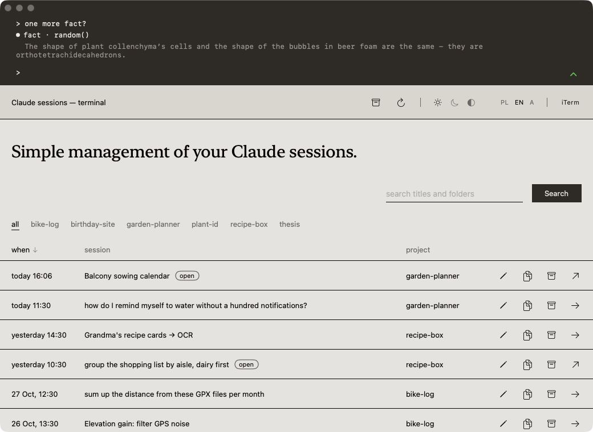
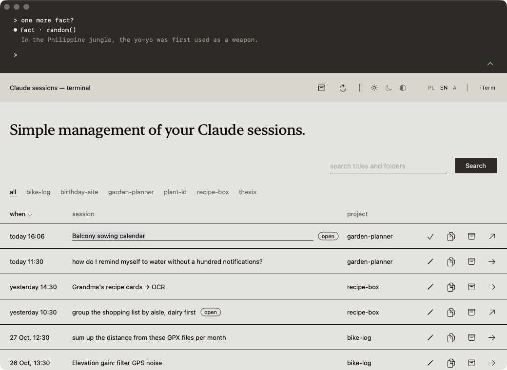
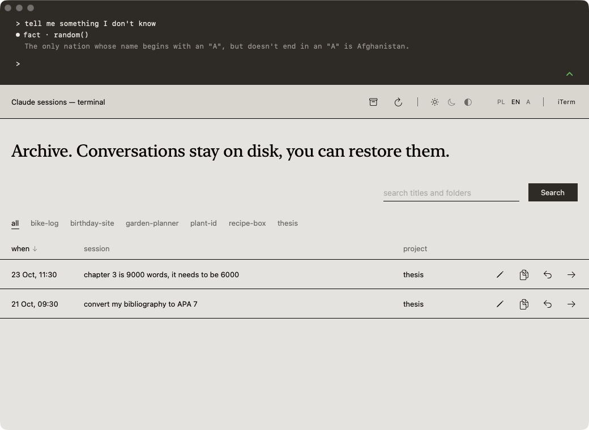
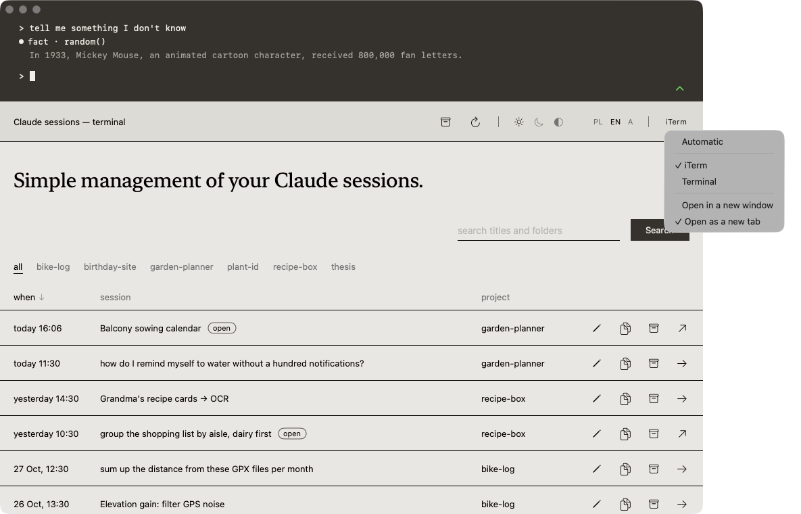
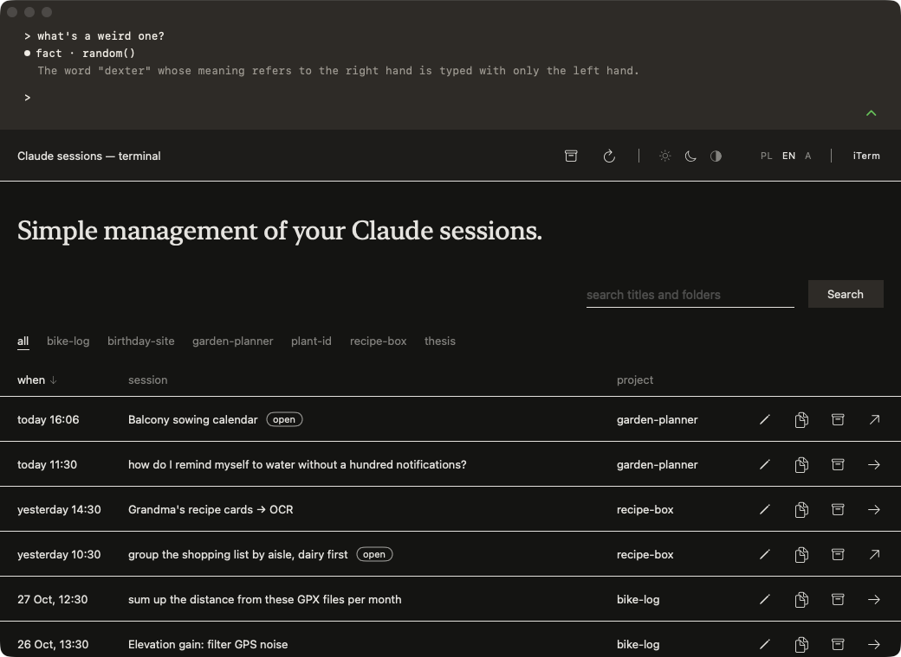
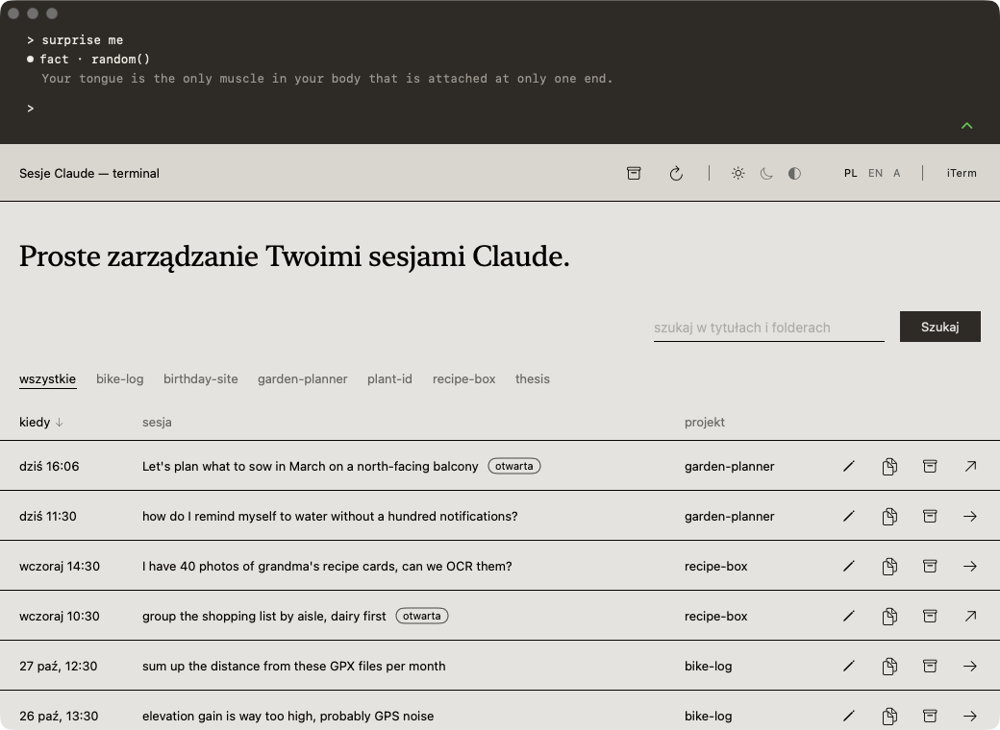

# Claude sessions · Sesje Claude

**A small macOS window that lists your Claude Code sessions and reopens any of them in your terminal.**
Free, open source, no account, no telemetry. Polish and English, light and dark.

*(Polska wersja niżej.)*



Claude Code keeps every conversation on disk, but finding the one from last Tuesday means
`claude --resume` and a list of ids. This app reads those same files and shows them as a list:
title, project folder, when it was last touched, which ones are running right now. Click one and it
opens in your terminal with the right folder and the right `--resume` id.

## Install

You need a Mac with **macOS 13 Ventura or newer**. Apple silicon (M1 and later) and Intel both work.

1. Go to [Releases](https://github.com/gosiarutkowska/claude-sessions/releases/latest) and download
   **`Sesje-Claude.zip`** (about 1 MB).
2. Double-click the zip. You get **Sesje Claude.app**.
3. Drag **Sesje Claude.app** into your **Applications** folder.
4. **First launch.** The app is signed by me, not by Apple, so a plain double-click shows
   *"Sesje Claude cannot be opened because the developer cannot be verified"*. Instead:
   **right-click the app → Open → Open**. You only do this once; afterwards it opens normally.
   If your Mac still refuses (macOS 15 is stricter), open **System Settings → Privacy & Security**,
   scroll down and click **Open Anyway** next to the app's name, or run in Terminal:
   ```sh
   xattr -dr com.apple.quarantine "/Applications/Sesje Claude.app"
   ```
5. **Automation permission.** The first time you resume a session, macOS asks whether the app may
   control your terminal (iTerm, Terminal…). Click **Allow**. Without it the app can still copy the
   resume command for you to paste. Changed your mind? **System Settings → Privacy & Security →
   Automation → Sesje Claude**.
6. Pick your terminal and how sessions should open (new window or new tab) in the **top-right corner**
   of the window. See [Terminals](#terminals) below.

**Update**: download the new zip and replace the app in Applications. Your titles and archive are kept.

**Uninstall**: drag the app to the Trash. To remove its two settings files too:
```sh
rm -rf ~/Library/Application\ Support/ClaudeSessions
```

## A tour of the window

### The list

- Shows your Claude Code sessions started from a terminal, across all projects. Transcripts of
  SDK-driven agents are skipped.
- Each row has the date, the title, the project and an **open** mark on sessions that are running right now.
- The list refreshes every 10 seconds; the ↻ icon in the bar refreshes it by hand.
- **Sort** by date, title or project by clicking a column header. A second click flips the order.
- **Project filter** above the table: one click shows a single project, "all" brings everything back.
- **Search** in titles and folders: type, then press Enter or the **Search** button; × clears it.

### Actions on a session

| Icon | What it does |
|---|---|
| → | Resumes the session in your terminal. |
| ↗ | Switches to the window of a session that is already open. The app never starts an open session a second time. |
| double-click | Same as → or ↗, whichever applies. |
| ✎ | Renames the session. Enter saves, Esc cancels, an empty title brings back the one from Claude Code. Titles live in the app's own file, Claude Code's files stay untouched. |
| ⎘ | Copies the resume command (`cd … && claude --resume …`) to the clipboard. |
| archive box | Moves the session to the archive, after a confirmation. It disappears from the list; the conversation stays on disk. |



### The archive

The box icon in the bar opens the archive: the sessions you hid. From here you can **restore** one to
the list or resume it directly. Nothing is ever deleted.



### Terminals

- Supported: **iTerm, Terminal, Ghostty, Warp, kitty, WezTerm, Alacritty**. The menu in the top-right
  corner lists only the ones installed on your Mac, plus "Automatically" (the first one found).
- **New window or new tab**: your choice, in the same menu. Tabs work in iTerm, Terminal, WezTerm and Warp.
- Switching to an open session lands on the exact tab in iTerm and Terminal. The other terminals
  are only brought to the front.
- Warp can't be told to run a command, so it opens in the session's folder with the command on the
  clipboard, ready to paste.



### Look and settings

- **Theme**: light, dark, or match the system (the sun, moon and half-circle icons).
- **Language**: Polish, English, or match the system (PL / EN / A).
- The **dark terminal strip** at the top is a looping Claude Code conversation: a prompt gets typed,
  a tool call runs, a random fun fact comes back from `uselessfacts.jsph.pl` (offline, a built-in list
  takes over). The green chevron folds it away and brings it back.
- The bar with the name and the settings stays at the top while you scroll.
- Hover any icon for a tooltip.
- Everything you set (theme, language, terminal, window or tab, sorting, folded strip) is remembered.



## What it doesn't do

- It doesn't read your conversations beyond what a title needs: the first prompt, the folder, and the
  title lines Claude Code appends.
- It doesn't delete anything. "Archive" only hides a session in this app.
- It doesn't sync, has no account and no settings in the cloud.

## Privacy

Everything stays on your Mac. The app reads `~/.claude/projects/*/*.jsonl` and `~/.claude/sessions/*.json`,
writes only its own two files under `~/Library/Application Support/ClaudeSessions/`, and makes exactly
one kind of network request: a random fact for the strip at the top, from `uselessfacts.jsph.pl`
(a free public API). Nothing about you or your sessions is sent anywhere.
No analytics, no crash reports, no update check.

## Build from source

```sh
git clone https://github.com/gosiarutkowska/claude-sessions.git
cd claude-sessions
./build-app.sh        # universal binary, assembles the .app and installs it to /Applications
```

Needs Xcode (Swift 5.9+). The icon is drawn by `swift Resources/make-icon.swift`.
To run the app against a folder of sample sessions instead of your own (tests, screenshots), set
`CLAUDE_SESSIONS_HOME=/path/to/folder` containing a `.claude/projects` tree.

## Made with AI

This app was written with Claude Code and is part of [aithatgives.org](https://aithatgives.org):
a shelf of apps made with AI and given away, free, with no ads and no data collection.
Licence: MIT.

---

## Po polsku

**Małe okno na macOS, które pokazuje listę sesji Claude Code i otwiera dowolną z nich w terminalu.**
Za darmo, otwarty kod, bez konta, bez telemetrii. Po polsku i po angielsku, jasny i ciemny motyw.



Claude Code trzyma każdą rozmowę na dysku, ale żeby wrócić do tej z zeszłego wtorku, trzeba
`claude --resume` i listy identyfikatorów. Ta aplikacja czyta te same pliki i pokazuje je jako listę:
tytuł, folder projektu, kiedy ostatnio ruszana, które działają w tej chwili. Klikasz i sesja otwiera się
w terminalu, we właściwym folderze, z właściwym `--resume`.

### Instalacja

Potrzebny Mac z **macOS 13 Ventura lub nowszym**, Apple silicon albo Intel.

1. Wejdź w [Releases](https://github.com/gosiarutkowska/claude-sessions/releases/latest) i pobierz
   **`Sesje-Claude.zip`** (ok. 1 MB).
2. Kliknij zip dwa razy. Pojawi się **Sesje Claude.app**.
3. Przeciągnij **Sesje Claude.app** do folderu **Programy** (Applications).
4. **Pierwsze uruchomienie.** Aplikacja jest podpisana przeze mnie, nie przez Apple, więc zwykły
   dwuklik pokaże *„Nie można otworzyć, ponieważ nie można zweryfikować dewelopera”*. Zamiast tego:
   **prawy przycisk na aplikacji → Otwórz → Otwórz**. Robisz to tylko raz. Jeśli Mac dalej odmawia
   (macOS 15 jest surowszy), wejdź w **Ustawienia systemowe → Prywatność i ochrona**, przewiń w dół
   i kliknij **Otwórz mimo to**, albo wpisz w Terminalu:
   ```sh
   xattr -dr com.apple.quarantine "/Applications/Sesje Claude.app"
   ```
5. **Zgoda na automatyzację.** Przy pierwszym wznowieniu sesji macOS zapyta, czy aplikacja może
   sterować Twoim terminalem (iTerm, Terminal…). Kliknij **Zezwól**. Bez tego aplikacja i tak skopiuje
   polecenie, które możesz wkleić. Zmiana zdania: **Ustawienia systemowe → Prywatność i ochrona →
   Automatyzacja → Sesje Claude**.
6. Terminal i sposób otwierania (nowe okno albo nowa karta) wybierasz w **prawym górnym rogu** okna.

**Aktualizacja**: pobierz nowy zip i podmień aplikację w Programach. Tytuły i archiwum zostają.

**Odinstalowanie**: przeciągnij aplikację do Kosza. Żeby usunąć też dwa pliki ustawień:
```sh
rm -rf ~/Library/Application\ Support/ClaudeSessions
```

### Co gdzie jest

**Lista sesji**
- Pokazuje Twoje sesje Claude Code uruchomione w terminalu, ze wszystkich projektów. Zapisy agentów
  sterowanych przez SDK są pominięte.
- Każdy wiersz ma datę, tytuł, projekt i znacznik „otwarta” przy sesjach, które teraz działają.
- Lista odświeża się co 10 s, a ikoną ↻ w pasku możesz ją odświeżyć ręcznie.
- Sortowanie po dacie, tytule i projekcie kliknięciem w nagłówek kolumny. Drugie kliknięcie odwraca kolejność.
- Filtr projektów nad tabelą.
- Wyszukiwarka po tytułach i folderach: linia do wpisania i przycisk „Szukaj” (albo Enter), × czyści wyszukiwanie.

**Akcje przy sesji**
- → wznawia sesję w terminalu.
- ↗ przełącza do okna sesji, która jest już otwarta. Otwartej sesji apka nigdy nie uruchamia drugi raz.
- Podwójne kliknięcie w wiersz działa jak → albo ↗.
- ✎ zmienia tytuł. Enter zapisuje, Esc anuluje, a pusty tytuł przywraca ten od Claude Code.
  Tytuły są w pliku apki, nie w plikach Claude Code.
- ⎘ kopiuje polecenie `cd … && claude --resume …`.
- Archiwizacja z potwierdzeniem: sesja znika z listy, ale rozmowa zostaje na dysku. Widok archiwum
  (ikona pudełka w pasku) pozwala przywrócić sesję.

**Terminale**
- Obsługiwane: iTerm, Terminal, Ghostty, Warp, kitty, WezTerm, Alacritty. W menu w prawym górnym rogu
  widać tylko te zainstalowane, plus opcja „Automatycznie”.
- Tryb otwierania do wyboru: nowe okno albo nowa karta (karta działa w iTermie, Terminalu, WezTermie i Warpie).
- Przełączanie do otwartej sesji trafia w konkretną kartę w iTermie i Terminalu. Pozostałe terminale
  apka tylko wysuwa na wierzch.
- Warp nie przyjmuje poleceń z zewnątrz, więc otwiera się w folderze sesji, a polecenie trafia do schowka.

**Wygląd i ustawienia**
- Motyw jasny, ciemny albo jak w systemie.
- Język polski, angielski albo jak w systemie (PL / EN / A).
- Ciemny pas terminala na górze z animacją: wpisane pytanie, wywołanie narzędzia i losowa ciekawostka
  z `uselessfacts.jsph.pl` (bez internetu działa lista zapasowa). Zielona strzałka chowa i pokazuje ten pas.
- Pasek z nazwą i ustawieniami zostaje na górze przy przewijaniu.
- Własne podpowiedzi po najechaniu na ikony.
- Wszystkie ustawienia (motyw, język, terminal, tryb otwierania, sortowanie, zwinięcie pasa) się zapamiętują.

### Czego nie robi

Nie czyta treści rozmów poza tym, co potrzebne do tytułu. Niczego nie kasuje: „archiwum” tylko chowa
sesję w tej aplikacji. Nie synchronizuje, nie ma konta.

### Prywatność

Wszystko zostaje na Twoim Macu. Aplikacja czyta `~/.claude/projects/*/*.jsonl` i `~/.claude/sessions/*.json`,
zapisuje tylko własne dwa pliki w `~/Library/Application Support/ClaudeSessions/` i wykonuje dokładnie jeden
rodzaj zapytania sieciowego: po losową ciekawostkę na pasek u góry, do `uselessfacts.jsph.pl` (darmowe
publiczne API). Nic o Tobie ani o Twoich sesjach nigdzie nie wychodzi. Bez analityki, raportów o błędach
i sprawdzania aktualizacji.

### Technicznie

macOS 13 lub nowszy, Maki z procesorem Apple i z Intelem. `./build-app.sh` buduje i instaluje apkę
do /Applications (potrzebny Xcode). Bez podpisu Apple, więc pierwsze uruchomienie wymaga prawego
kliknięcia i „Otwórz”.

Zrobiona z pomocą Claude Code, część [aithatgives.org](https://aithatgives.org). Licencja MIT.
